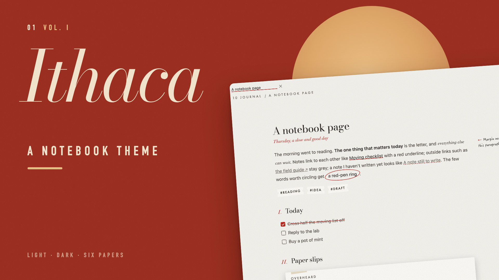
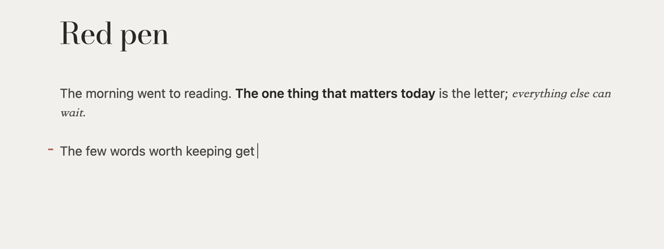
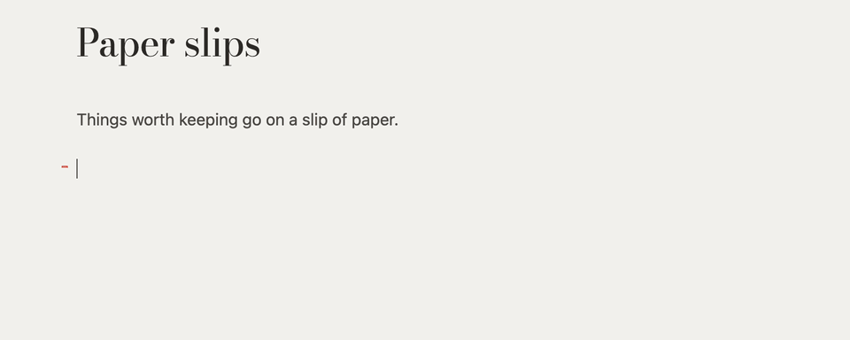
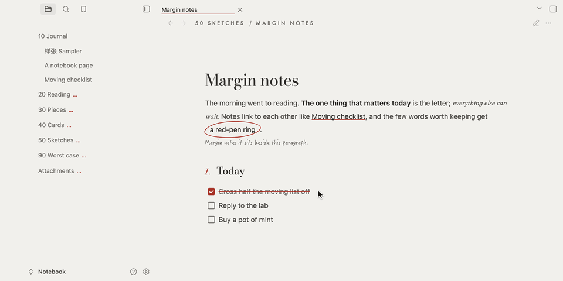
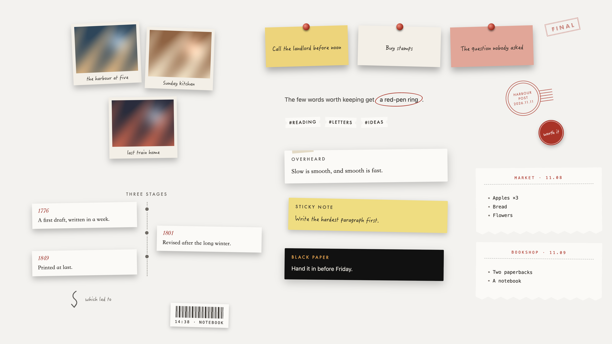
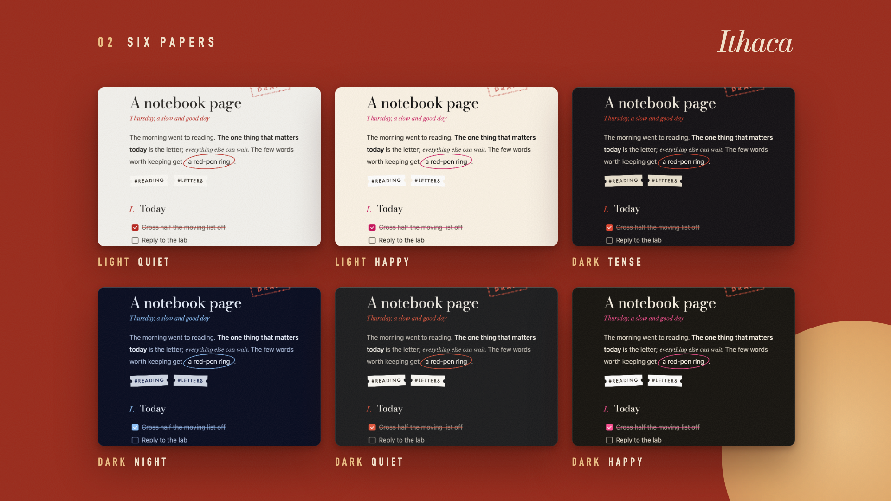
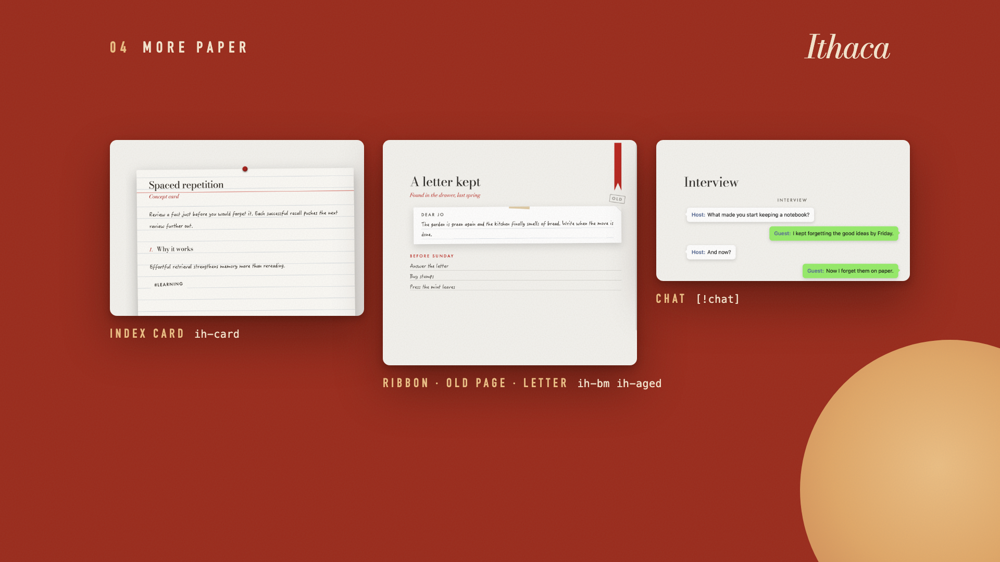
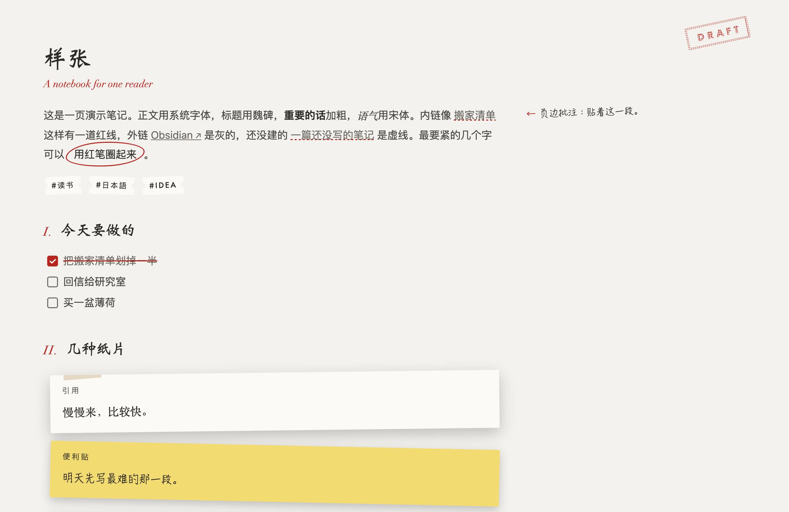
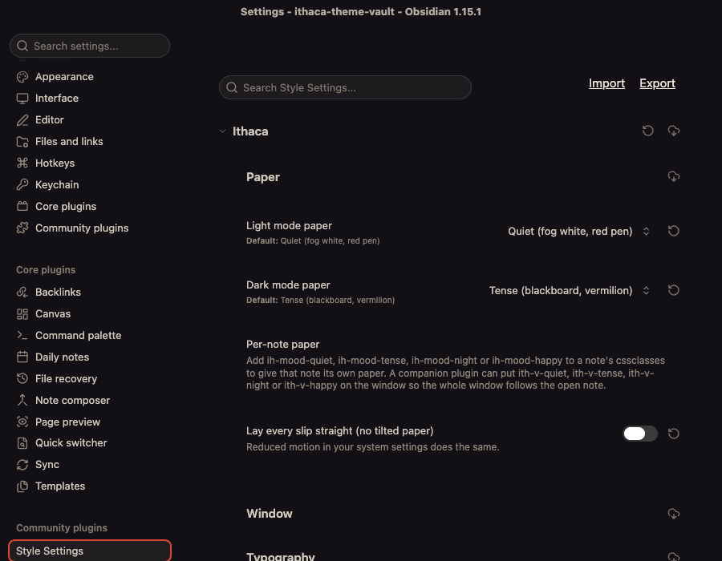
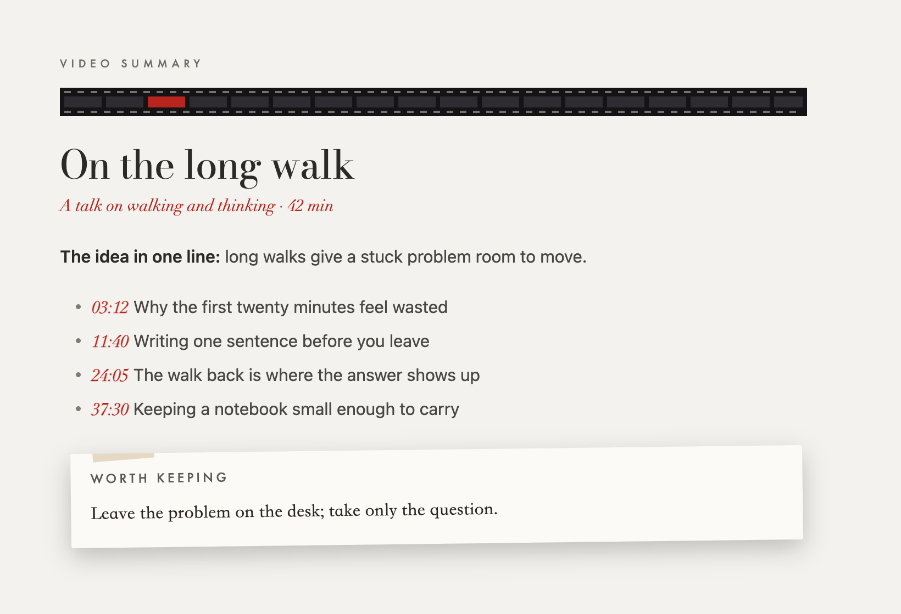

# Ithaca



**Your vault, kept like a paper notebook.**

[](https://community.obsidian.md/themes/ithaca)

A paper notebook has a few habits no app copies: a red pen for the words that matter, slips taped in, a note squeezed into the margin. Ithaca brings those habits into Obsidian. The whole window is one sheet of paper, with no panel frames and no tab chrome.

**Circle what matters.** Wrap a few words in `ih-circ` and the red pen rings them, in Live Preview and in reading view.



**Callouts become paper.** Quotes are taped slips, tips are sticky notes, warnings are black paper, each laid down a little crooked.



**Notes in the margin.** When the pane is wide enough, margin notes and footnotes move beside the paragraph they belong to.



**A drawer of notebook pieces.** A photo wall, pinned notes, a timeline, receipts, a postmark, a sticker, a barcode, rubber stamps. All of them are Markdown callouts or one-word spans.



**Six papers, light and dark.** Two light papers and four dark ones, each checked for 4.5:1 text contrast. Pick one for each mode in Style Settings, or give a single note its own paper with `ih-mood-*`.



**More paper.** An index card, a bookmark ribbon, a yellowed old page, letter paper and ruled lines, chat bubbles.



**Made for Chinese and Japanese too.** Chinese titles get Weibei, quotes get Songti or Mincho, and margin notes get a handwritten face.



**As fast as the default theme.** No `:has()` selectors and a single `!important`. On Obsidian 1.15, the median note opened in 17.7–19.3 ms with Ithaca and 18.0–18.6 ms with the default theme (120 opens each), with no long tasks.

**Fits a phone.** At 390 px the slips, photos and timeline reflow into one column, and margin notes drop back into the text.


[English](#english) · [中文](#中文) · [日本語](#日本語)

---

## English

### Install

- **Community themes** (once listed): Settings → Appearance → Themes → Manage → search “Ithaca” → Install and use.
- **By hand:** create `.obsidian/themes/Ithaca/` in your vault, put `theme.css` and `manifest.json` from the latest release in it, then pick Ithaca in Settings → Appearance → Themes.

Ithaca makes no network requests. Its Latin fonts are embedded (see [Fonts](#fonts)).

If your notes start with their own `# Title`, turn off Settings → Appearance → **Show inline title** so the title isn't shown twice.

### Style Settings

With the [Style Settings](https://github.com/mgmeyers/obsidian-style-settings) plugin you can change:

| Group | Option | Default |
|---|---|---|
| Paper | Light-mode paper: Quiet / Happy | Quiet |
| | Dark-mode paper: Tense / Night / Quiet / Happy | Tense |
| | Lay every slip straight (no tilt) | off |
| Window | Hide the tab bar until the pointer reaches the top | off |
| | Always show ribbon icons | off |
| | Handwritten title above the file list, and its text | off |
| Typography | Use the bundled open fonts everywhere | off |
| | No Roman numerals before H2 | off |
| | Keep footnotes at the bottom instead of the margin | off |
| | Desk lamp: dim every paragraph but the one under the pointer | off |
| | Signature at the end of each note, and its text | off |
| Labels | Backlinks label, stamp words, old-page mark | English |

Without Style Settings you get the defaults. Setting titles follow Obsidian's language (English, 中文, 日本語).



### Notebook marks

**In a note's `cssclasses`:**

| Class | What it does |
|---|---|
| `ih-mood-quiet` · `ih-mood-tense` · `ih-mood-night` · `ih-mood-happy` | This note gets its own paper |
| `ih-stamp-draft` · `-final` · `-sent` · `-wait` · `-done` | A rubber stamp in the top-right corner |
| `ih-bm` | A bookmark ribbon hanging from the top edge |
| `ih-card` | The note becomes a ruled index card |
| `ih-aged` · `ih-aged-2` | Yellowed tape and a corner mark for old pages |

**Inline HTML:**

```html
<span class="ih-sub">A subtitle under the title</span>
<span class="ih-circ">the few words that matter</span>
<span class="ih-mg">a margin note beside this paragraph</span>
<span class="ih-mg ih-sticky">a sticky note in the margin</span>
<span class="ih-sticker">worth it</span>            <!-- add is-red for a red one -->
<span class="ih-postmark">Harbour post<br>2026.11.11</span>
<span class="ih-barcode">14:38 · NOTEBOOK</span>
<span class="ih-arrow">which led to</span>         <!-- alone on its line -->
```

Margin notes and footnotes move into the right margin when Settings → Editor → **Readable line length** is on and the pane is at least 1000px wide. Otherwise they stay in the text.

**Images:** put `photo` in the alt text (`![[pic.jpg|photo]]`) for a white-bordered print. Add `left` or `right` to float it.

**Callouts:**

| Type | Looks like |
|---|---|
| `quote` `example` `cite` | Taped paper |
| `tip` `todo` `question` | Sticky note |
| `warning` `danger` `bug` … | Black paper |
| `note` `info` `summary` … | Plain, one red rule |
| `receipt` · `receipts` | Thermal receipt with a barcode · a row of them |
| `letter` · `lined` | Lined letter paper · ruled lines to write on |
| `ledger` | One item per line, dashed rules |
| `slips` · `stickies` · `tickets` | Each list item a paper slip · sticky note · ticket stub |
| `photos` | Each list item `![[pic.jpg]] caption` a print on a photo wall |
| `timeline` | Each item `**1776** what happened`, cards left and right of a line |
| `pinned` | Each item a pinned note |
| `chat` | Each item `**Name:** words`, speech bubbles |
| `old` | A yellowed slip |

```markdown
> [!timeline] Three stages
> - **1776** A first draft
> - **1801** Revised after the winter
```

The `demo/` folder has sample notes for all of these.

### Companion plugins

**Plugin notes get their own look.** A Video Summary note gets a strip of film under its header and red timestamps.



Notes written by these plugins get their own look; the plugin only adds a class.

| Class | Plugin | Look |
|---|---|---|
| `ih-film` | Video Summary | A strip of film under the header, timestamps in red italic |
| `ih-receipt` | AI Accounting | The monthly summary as a thermal receipt |
| `ih-clip` | Polyglot Helper | Word entries as clippings |
| `[!abstract\|said-today …]` | Said Today | A small “Said” label and one red rule |

A plugin can also put `ith-v-quiet`, `ith-v-tense`, `ith-v-night` or `ith-v-happy` on the window so the whole window takes the open note's paper.

### Fonts

| Role | macOS | Elsewhere |
|---|---|---|
| Numbers, Latin titles | Didot / **Ithaca Display** | **Ithaca Display** (Bodoni Moda, embedded) |
| Small labels | Futura | **Ithaca Label** (Jost, embedded) |
| Handwriting | HanziPen SC | **Ithaca Hand** (Patrick Hand, embedded), LXGW WenKai / KaiTi for Chinese |
| Signature | Snell Roundhand | **Ithaca Script** (Pinyon Script, embedded) |
| Chinese titles | Weibei SC | Source Han Serif / Noto Serif SC / SimSun |
| Quotes | Songti SC / Hiragino Mincho | Noto Serif SC / JP, Georgia, Yu Mincho |

On macOS, Weibei SC and HanziPen SC are free but not installed by default: open Font Book and download them. On Windows and Linux, installing [LXGW WenKai](https://github.com/lxgw/LxgwWenKai) gives Chinese handwriting its intended look.

### Performance

Ithaca has no `:has()` selectors and only one `!important`. Obsidian's own stylesheet sets `contain: paint !important` on editor widgets, which cuts a callout's shadow into a hard line, and nothing weaker can lift it. Measured on Obsidian 1.15 by opening five sample notes 30 times each in reading and editing view, twice per theme: median 17.7 and 19.3 ms with Ithaca, 18.0 and 18.6 ms with the default theme, and no long tasks with Ithaca.

### Build

`theme.css` is generated: edit `src/theme.src.css`, then run `python3 tools/build.py`. The script embeds `fonts/*.woff2` (Latin subsets).

### License

MIT, see [LICENSE](LICENSE). The embedded fonts are under the SIL Open Font License 1.1, see [fonts/licenses](fonts/licenses).

---

## 中文

### 安装

- **社区主题**（上架后）：设置 → 外观 → 主题 → 管理 → 搜索 “Ithaca” → 安装并使用。
- **手动：** 在库里新建 `.obsidian/themes/Ithaca/`，放入最新版本的 `theme.css` 和 `manifest.json`，再到 设置 → 外观 → 主题 里选 Ithaca。

主题不联网，西文字体已内嵌。没有 `:has()`，实测打开笔记和默认主题一样快（中位数约 18 ms）；手机宽度下纸片、相片、时间线会排成一列。笔记开头自己写了 `# 标题` 的，可以在 设置 → 外观 关掉“显示内嵌标题”，免得标题出现两次。

### Style Settings 选项

装 [Style Settings](https://github.com/mgmeyers/obsidian-style-settings) 后可以调：浅色和深色各用哪种纸、纸片放正、藏标签栏、工具条常显、文件列表顶上的手写题字、西文一律用自带字体、二级标题前的罗马数字、脚注放页边还是页底、台灯、笔记末尾签名，以及反向链接前的一句、印章上的字、旧页角标。

### 手账标记

`cssclasses`：`ih-mood-*`（这一篇换纸）、`ih-stamp-*`（盖章）、`ih-bm`（书签丝带）、`ih-card`（索引卡）、`ih-aged`（旧页）。

正文：`ih-sub`（副题）、`ih-circ`（红笔圈）、`ih-mg`（页边批注）、`ih-mg ih-sticky`（页边便利贴）、`ih-sticker`（圆贴纸）、`ih-postmark`（邮戳）、`ih-barcode`（条码）、`ih-arrow`（手绘箭头）。图片说明写 `照片` 或 `photo` 变成白边相片。

callout 除了内置类型，还有 `receipt`、`receipts`、`letter`、`lined`、`ledger`、`slips`、`stickies`、`tickets`、`photos`（相片墙）、`timeline`（交错纸卡）、`pinned`（图钉便利贴）、`chat`（对话气泡）、`old`（泛黄旧纸条）。`demo/` 里有每种的示例。

配套插件（Video Summary、AI Accounting、Polyglot Helper、Said Today）写出的笔记各有自己的样子；插件也可以在窗口上挂 `ith-v-*`，让整扇窗跟着当前笔记换纸。

### 字体

魏碑和翩翩体是 macOS 的免费字体，但默认没装，要去“字体册”下载。Windows、Linux 建议装[霞鹜文楷](https://github.com/lxgw/LxgwWenKai)，中文手写体才是设计的样子。

---

## 日本語

### インストール

- **コミュニティテーマ**（掲載後）：設定 → 外観 → テーマ → 管理 → 「Ithaca」を検索 → インストールして使用。
- **手動：** Vault に `.obsidian/themes/Ithaca/` を作り、最新リリースの `theme.css` と `manifest.json` を入れて、設定 → 外観 → テーマで Ithaca を選びます。

ネットワーク通信はしません。欧文フォントは埋め込み済みです。`:has()` は使っておらず、ノートを開く速さは標準テーマと同じです（中央値 約 18 ms）。スマートフォンの幅では紙片・写真・年表が一列に並びます。ノートの先頭に `# 見出し` を書く場合は、設定 → 外観 →「インラインタイトルを表示」をオフにしてください。

### しるし

`cssclasses` に `ih-mood-*`（ノートごとの紙）、`ih-stamp-*`（スタンプ）、`ih-bm`（しおり）、`ih-card`（インデックスカード）、`ih-aged`（古いページ）。本文では `ih-sub`・`ih-circ`・`ih-mg`・`ih-sticker`・`ih-postmark`・`ih-barcode`・`ih-arrow`。callout には `receipt`・`letter`・`lined`・`ledger`・`slips`・`stickies`・`tickets`・`photos`・`timeline`・`pinned`・`chat`・`old` を追加しています。例は `demo/` にあります。

### フォント

macOS の「魏碑」「翩翩体」は無料ですが標準では入っていないため、Font Book からダウンロードしてください。Windows・Linux では [LXGW WenKai](https://github.com/lxgw/LxgwWenKai) をおすすめします。
