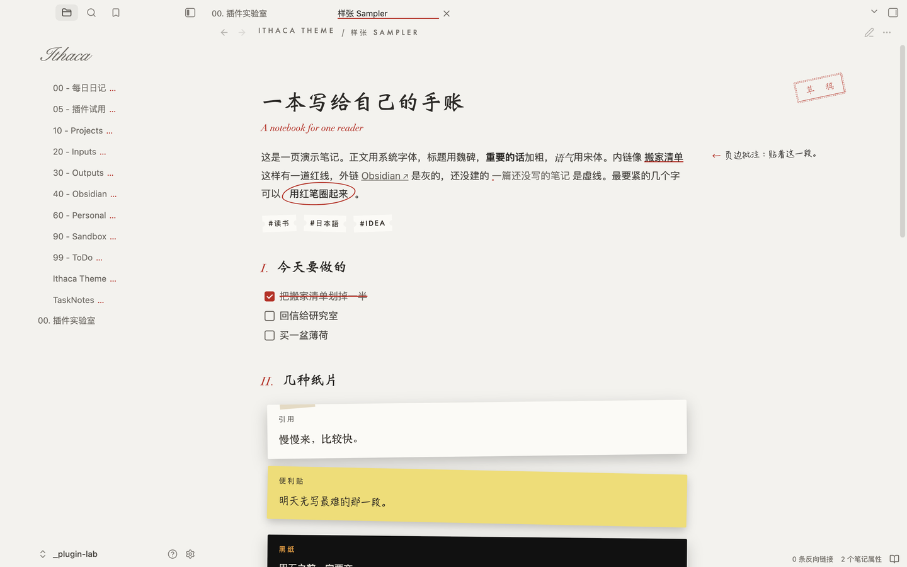
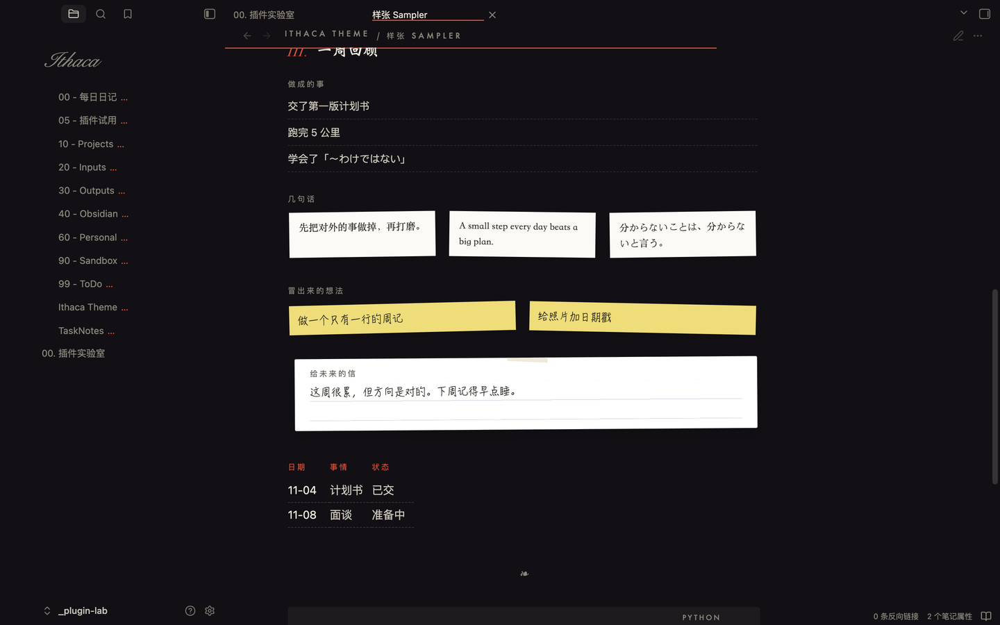
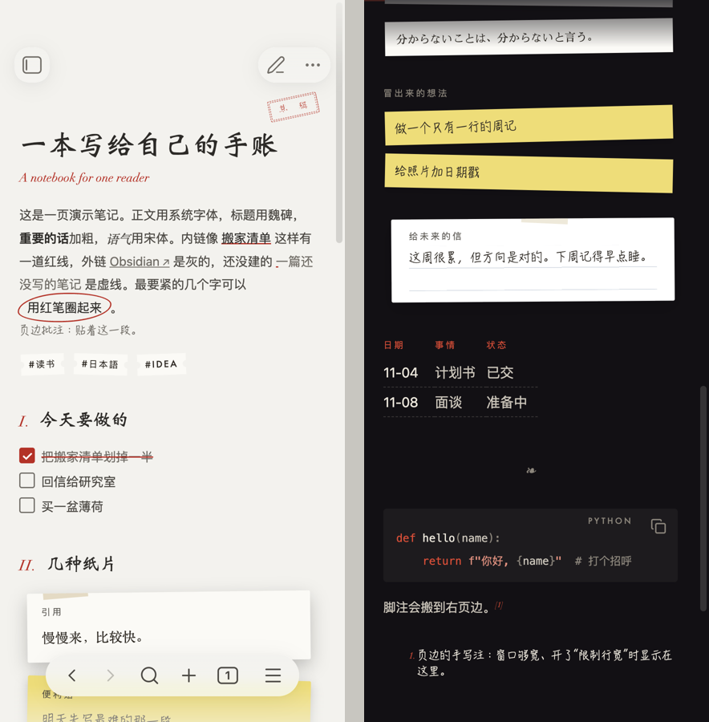

# Ithaca

A notebook theme for Obsidian. 一本手账样子的 Obsidian 主题。手帳のような Obsidian テーマ。







[English](#english) · [中文](#中文) · [日本語](#日本語)

---

## English

### Install

- **From the community directory** (once listed): Settings → Appearance → Themes → Manage → search “Ithaca” → Install and use.
- **By hand:** create `.obsidian/themes/Ithaca/` in your vault, put `theme.css` and `manifest.json` from the latest release in it, then pick Ithaca in Settings → Appearance → Themes.

Ithaca makes no network requests. Its three Latin fonts are embedded (see [Fonts](#fonts)).

### Style Settings

Install the [Style Settings](https://github.com/mgmeyers/obsidian-style-settings) plugin to change these:

| Group | Option | Default |
|---|---|---|
| Paper | Light-mode paper: Quiet / Happy | Quiet |
| | Dark-mode paper: Tense / Night / Quiet / Happy | Tense |
| Window | Hide the tab bar until the pointer reaches the top | off |
| | Always show ribbon icons | off |
| | Handwritten title above the file list, plus its text | off, empty |
| Typography | Use the bundled open fonts everywhere | off |
| | No Roman numerals before H2 | off |
| | Keep footnotes at the bottom instead of the margin | off |
| | Desk lamp: dim every paragraph but the one under the pointer | off |
| | Signature at the end of each note, plus its text | off, empty |
| Labels | Empty-note hint, backlinks label, stamp words | |

Without Style Settings you get the defaults.

### Notebook marks

Add these by hand, or let a companion plugin insert them (coming later).

**In a note's `cssclasses`:**

| Class | What it does |
|---|---|
| `ih-mood-quiet` · `ih-mood-tense` · `ih-mood-night` · `ih-mood-happy` | This note gets its own paper |
| `ih-stamp-draft` · `-final` · `-sent` · `-wait` · `-done` | A rubber stamp in the top-right corner |
| `ih-bm` | A bookmark ribbon hanging from the top edge |
| `ih-card` | The note becomes a ruled index card |
| `ih-aged` · `ih-aged-2` | Yellowed tape and a corner mark for old pages |

**Inline HTML:**

```html
<span class="ih-sub">A subtitle under the title</span>
<span class="ih-circ">the words that matter</span>
<span class="ih-mg">a margin note beside this paragraph</span>
<span class="ih-mg ih-sticky">a sticky note in the margin</span>
```

Margin notes and footnotes move into the right margin when Settings → Editor → **Readable line length** is on and the pane is at least 1000px wide. Otherwise they stay in the text.

**Images:** put `photo` in the alt text (`![[pic.jpg|photo]]`) to get a white-bordered print. Add `left` or `right` to float it.

**Callouts:**

| Type | Looks like |
|---|---|
| `quote` `example` `cite` | Taped paper |
| `tip` `todo` `question` | Sticky note |
| `warning` `danger` `bug` … | Black paper |
| `note` `info` `summary` … | Plain, one red rule |
| `receipt` | Thermal receipt with a barcode |
| `letter` | Lined letter paper |
| `lined` | Ruled lines to write on |
| `ledger` | One item per line, dashed rules |
| `slips` | Each list item a paper slip |
| `stickies` | Each list item a sticky note |
| `tickets` | Each list item a ticket stub |

```markdown
> [!slips] This week
> - First thing
> - Second thing
```

### Fonts

| Role | macOS | Elsewhere |
|---|---|---|
| Numbers, Latin titles | Didot | **Ithaca Display** (Bodoni Moda, embedded) |
| Small labels | Futura | **Ithaca Label** (Jost, embedded) |
| Signature | Snell Roundhand | **Ithaca Script** (Pinyon Script, embedded) |
| Chinese titles | Weibei SC | Source Han Serif / Noto Serif SC / SimSun |
| Handwriting | HanziPen SC | LXGW WenKai / KaiTi |
| Quotes | Songti SC / Hiragino Mincho | Noto Serif SC / JP, Yu Mincho |

On macOS, Weibei SC and HanziPen SC are free but not installed by default: open Font Book and download them. On Windows and Linux, installing [LXGW WenKai](https://github.com/lxgw/LxgwWenKai) gives the handwriting its intended look.

### License

MIT, see [LICENSE](LICENSE). The embedded fonts are under the SIL Open Font License 1.1, see [fonts/licenses](fonts/licenses).

### Build

`theme.css` is generated: edit `src/theme.src.css`, then run `python3 tools/build.py`. The script embeds `fonts/*.woff2`.

---

## 中文

### 安装

- **社区主题库**（上架后）：设置 → 外观 → 主题 → 管理 → 搜索 “Ithaca” → 安装并使用。
- **手动：** 在库里新建 `.obsidian/themes/Ithaca/`，放入最新版本的 `theme.css` 和 `manifest.json`，再到 设置 → 外观 → 主题 里选 Ithaca。

主题不联网。三套西文字体已内嵌。

### Style Settings 选项

装 [Style Settings](https://github.com/mgmeyers/obsidian-style-settings) 插件后可以调：浅色和深色各自用哪种纸、藏标签栏、工具条常显、文件列表顶上的手写题字、西文一律用自带开源字体、二级标题前的罗马数字、脚注放页边还是页底、台灯、笔记末尾签名，以及空白笔记提示、反向链接前的一句、印章上的字。不装插件就是默认样子。

### 手账标记

写在笔记的 `cssclasses` 里：

- `ih-mood-quiet` / `ih-mood-tense` / `ih-mood-night` / `ih-mood-happy`：这一篇换自己的纸色
- `ih-stamp-draft` / `-final` / `-sent` / `-wait` / `-done`：右上角盖章
- `ih-bm`：顶边垂一条书签丝带
- `ih-card`：整篇变成横线索引卡
- `ih-aged` / `ih-aged-2`：旧页，胶带发黄、角上一个“旧”字

写在正文里：`<span class="ih-sub">副题</span>`、`<span class="ih-circ">红笔圈</span>`、`<span class="ih-mg">页边批注</span>`、`<span class="ih-mg ih-sticky">页边便利贴</span>`。图片的说明文字写 `照片` 或 `photo`，就变成白边相片，再加 `left` / `right` 可以靠边。

页边批注和脚注，要在 设置 → 编辑器 → **限制行宽** 打开、并且这一栏至少 1000px 宽时，才会挪到右页边；否则留在正文里。

callout 除了内置类型，还多了 `receipt`（小票）、`letter`（信纸）、`lined`（横线纸）、`ledger`（一行一件）、`slips`（纸条）、`stickies`（便利贴）、`tickets`（票根）。后四种按列表排，每一项一张。

### 字体

魏碑和翩翩体是 macOS 自带的免费字体，但默认没装，要去“字体册”里下载。Windows、Linux 建议装[霞鹜文楷](https://github.com/lxgw/LxgwWenKai)，手写体才是设计的样子。

以后会有配套插件，用来插入这些标记。

---

## 日本語

### インストール

- **コミュニティテーマ**（掲載後）：設定 → 外観 → テーマ → 管理 → 「Ithaca」を検索 → インストールして使用。
- **手動：** Vault に `.obsidian/themes/Ithaca/` を作り、最新リリースの `theme.css` と `manifest.json` を入れて、設定 → 外観 → テーマで Ithaca を選びます。

ネットワーク通信はしません。欧文フォント 3 種を埋め込んでいます。

### Style Settings

[Style Settings](https://github.com/mgmeyers/obsidian-style-settings) プラグインで、ライト／ダークそれぞれの紙、タブバーを隠す、リボンを常に表示、ファイル一覧上の手書きタイトル、同梱フォントの使用、H2 のローマ数字、脚注の位置、デスクランプ、署名、各種ラベルを変更できます。

### 手帳のしるし

`cssclasses` に `ih-mood-*`（ノートごとの紙）、`ih-stamp-*`（スタンプ）、`ih-bm`（しおり）、`ih-card`（インデックスカード）、`ih-aged`（古いページ）。本文では `ih-sub`（副題）、`ih-circ`（赤丸）、`ih-mg`（余白の書き込み）、`ih-mg ih-sticky`（余白の付箋）。

余白の書き込みと脚注は、設定 → エディタ → **行の長さを制限** がオンで、ペインの幅が 1000px 以上のときに右の余白へ移ります。

callout には `receipt`・`letter`・`lined`・`ledger`・`slips`・`stickies`・`tickets` を追加しています。

### フォント

macOS の「魏碑」「翩翩体」は無料ですが標準では入っていないため、Font Book からダウンロードしてください。Windows・Linux では [LXGW WenKai](https://github.com/lxgw/LxgwWenKai) をおすすめします。

これらのしるしを挿入するコンパニオンプラグインを今後公開予定です。
